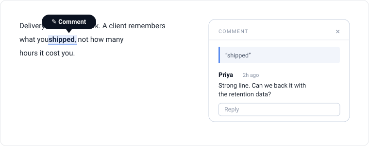

# Comment layer

Highlight-to-comment for any HTML page. Readers select text, leave a note, and
the comment anchors to the words themselves, so it survives edits and
re-renders. No framework, no build step, no login. Two files to get running.

It's the review layer built into a series of internal sites, extracted so you
can drop it into your own work.



## What you get

- **Select-to-comment.** Highlight any text, a bubble appears, leave a threaded
  comment. Replies, author-only delete, names remembered.
- **Anchored highlights.** Comments attach to the quoted text plus its
  surrounding context, not to a DOM path — so they hold up when the page changes.
- **Viewing / commenting modes.** Read with links live; switch to commenting
  (from the top bar, or just by starting a comment) and in-view links go inert so
  text is clean to select — including link text itself.
- **Local by default, shared when you want.** With no backend, each visitor's
  comments live in their own browser. Add the included Cloudflare Worker and
  everyone sees the same threads.
- **Markdown export.** One click pulls every comment out grouped by page and by
  the passage it sits on. Made to paste straight into Claude for triage.
- **Themeable.** Every color and font reads a CSS variable with a fallback. On a
  bare page it looks fine; on a page with a design system it inherits the tokens.
- **One config object.** Everything site-specific lives in a `window.CommentLayer`
  block. You never edit the library files.

## Quickstart (no backend)

Copy `comment-layer.css` and `comment-layer.js` into your project, then add this
to the page, in the `<head>`:

```html
<script>
  window.CommentLayer = {
    docId: "my-doc",         // namespaces stored comments
    viewSelector: "main"     // the element whose text is commentable
  };
</script>
<link rel="stylesheet" href="comment-layer.css">
<script src="comment-layer.js" defer></script>
```

That's it. Select text in `<main>` and comment. Comments are saved in the
visitor's browser (localStorage). Good for a solo read-through; not shared.

## Make it a shared review

To have a team see each other's comments, deploy the small Cloudflare Worker in
[`backend/`](backend/) (serves your site + a D1-backed `/api`), then flip one
line:

```html
<script>
  window.CommentLayer = {
    docId: "my-doc",
    viewSelector: "main",
    backend: "/api"          // <- shared store; the only change
  };
</script>
```

Full walkthrough in [`backend/README.md`](backend/README.md).

## Try it first

```bash
python3 -m http.server 8000
# http://localhost:8000/examples/01-local-only/   — smallest setup
# http://localhost:8000/examples/02-multi-page/   — theming + multi-page + export
```

See [`examples/`](examples/).

## Documentation

- **[docs/INTEGRATION.md](docs/INTEGRATION.md)** — every config option, theming,
  common gotchas (what's commentable, where the control lands, SPAs).
- **[docs/HOW-IT-WORKS.md](docs/HOW-IT-WORKS.md)** — the anchoring algorithm, the
  storage adapter, the data model. Read this before you change the library.
- **[backend/README.md](backend/README.md)** — deploy, access control, exporting.

## What this is not

- **Not auth.** Names are honor-system; delete is gated by a per-browser token,
  not a login. Fine for internal review, not for anything adversarial.
- **Not a general annotation engine.** It anchors to text you can select inside
  one container. It doesn't annotate images, or ranges spanning skipped regions.
- **Not real-time.** Comments load when the page loads. No live cursors or push.

## Files

```
comment-layer.js     the library (config-driven, don't edit)
comment-layer.css    styles (CSS-variable themeable)
backend/             Cloudflare Worker + D1 for shared comments
examples/            two runnable, no-build examples
docs/                integration + architecture
```

## License

MIT. See [LICENSE](LICENSE).
